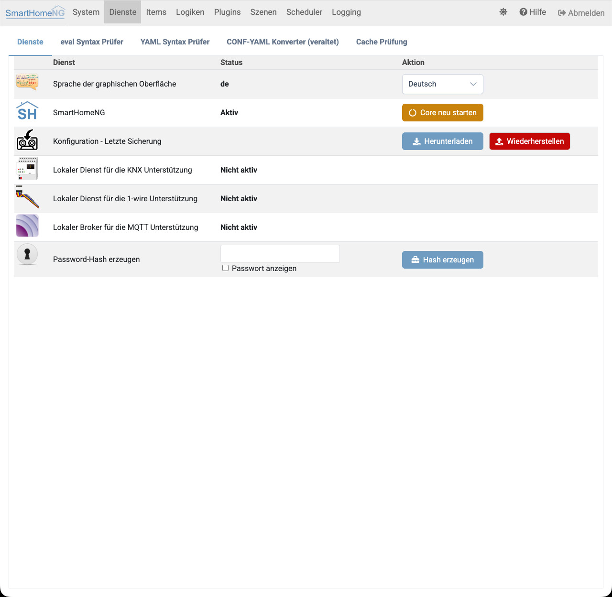
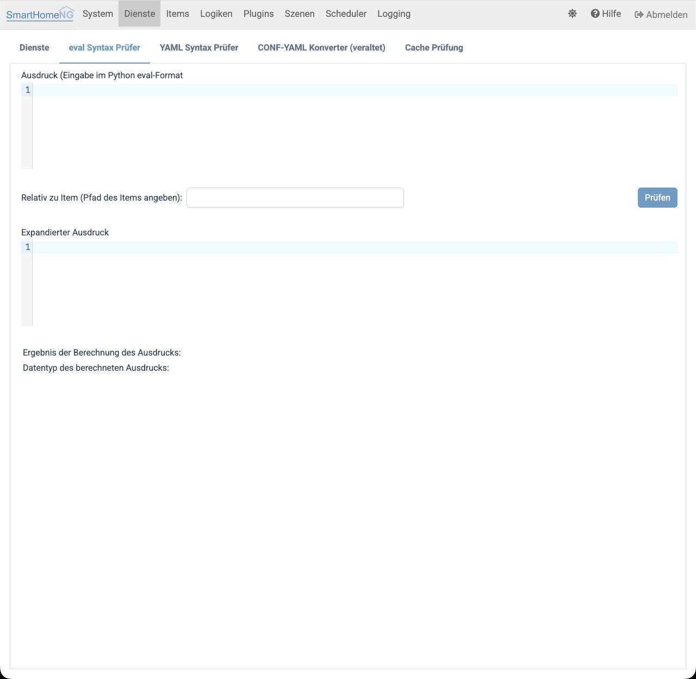
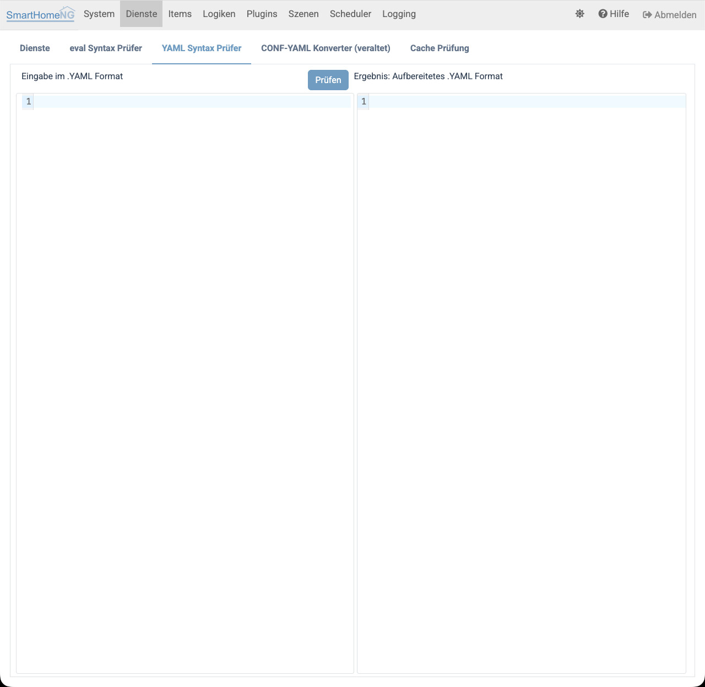
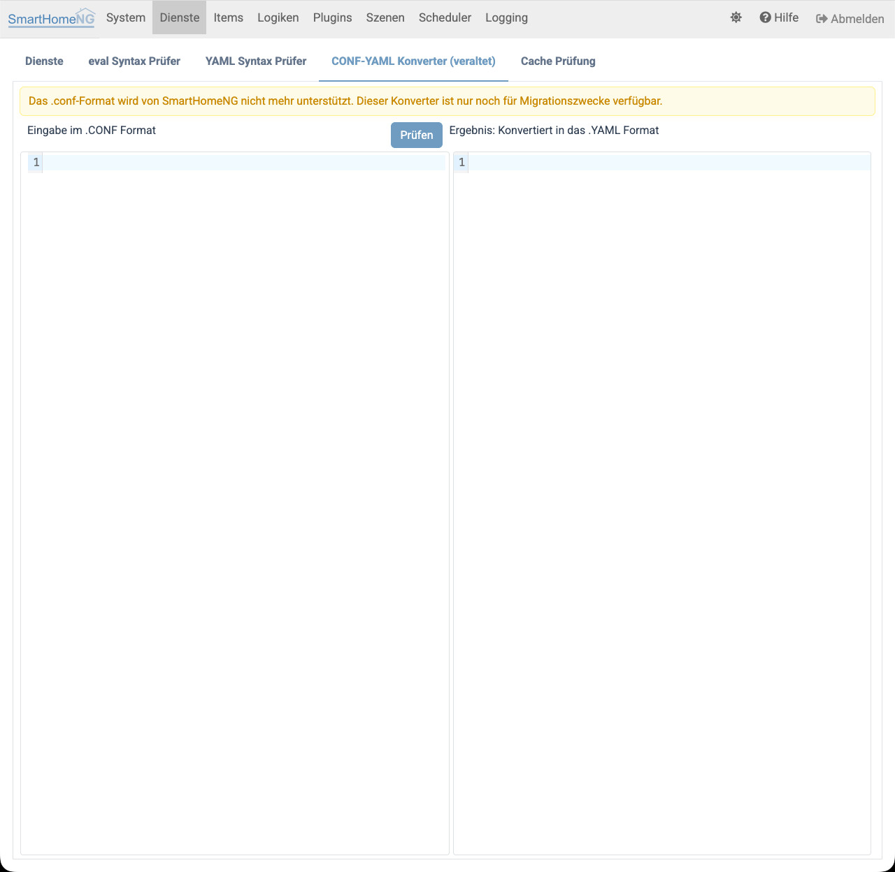
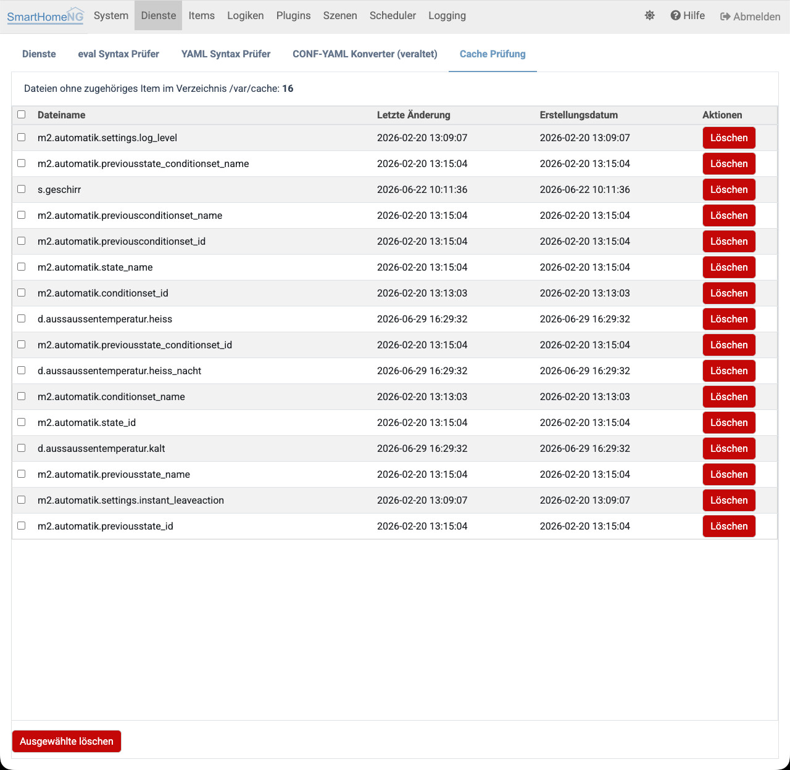
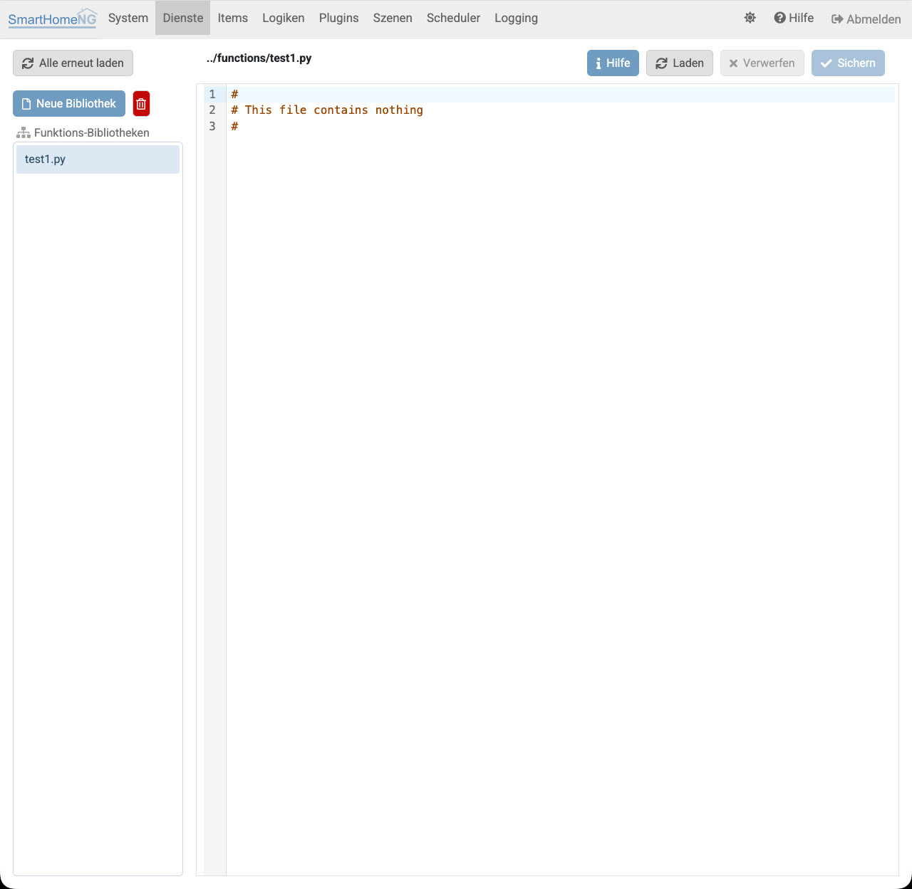

.. index:: Admin GUI; Dienste
.. index:: Dienste; Admin GUI

=======
Dienste
=======

Auf dem Dienste Tab kann temporär die Sprache von SmartHomeNG umgeschaltet werden. Außerdem ist es möglich, den Core von
SmartHomeNG neu zu starten oder zu stoppen, den Core und die Plugins aus Git zu aktualisieren, den Rechner auszuschalten
oder neu zu starten und Password-Hashes zu erzeugen (z.B. für das CLI Plugin).

Weiterhin kann der Status einiger von Plugins genutzter Dienste angesehen werden, soweit diese Dienste auf dem selben
Rechner laufen wie SmartHomeNG selbst.

Übersicht
=========

Auf diesem Tab können folgende Funktionen ausgelöst werden:

* **Core neu starten** und **Core stoppen**

  Diese Funktionen setzen voraus, dass SmartHomeNG läuft. Nach dem Stoppen ist SmartHomeNG (und damit auch das
  Administrations-Interface) nicht mehr erreichbar, bis es auf dem Rechner wieder gestartet wird.

.. index:: Git Pull; Admin GUI
.. index:: Admin GUI; Aktualisieren aus Git

* **Von Git aktualisieren**: Aktualisieren des Core (**Core**), der Plugins (**Plugins**) oder von beidem (**Alle**)

  Zu jedem Checkout wird angezeigt, ob er aktuell ist oder wie viele neue Commits im Upstream vorliegen
  (**Auf neue Commits prüfen** fragt den Upstream erneut ab). Die Aktualisierung erfolgt nur als Fast-Forward. Ist
  das nicht möglich (z.B. lokale Änderungen, abgewichener Branch oder kein Upstream), wird nichts geändert und der
  Grund angezeigt. Bei **Alle** werden entweder beide Checkouts aktualisiert oder keiner.

  Die Aktualisierung ändert nur die Dateien auf der Festplatte; der laufende Core verwendet den geladenen Code, bis er
  neu gestartet wird. Im Ergebnis wird angezeigt, ob ein Neustart des Core notwendig ist, oder ob es genügt, die
  aktualisierten Plugins neu zu laden.

.. index:: Rechner ausschalten; Admin GUI
.. index:: Admin GUI; Rechner neu starten

* **Rechner (Host)**: Ausschalten oder Neustarten des Rechners, auf dem SmartHomeNG läuft

  Diese Buttons stehen nur zur Verfügung, wenn in der ``etc/smarthome.yaml`` der Parameter
  ``allow_system_power: true`` gesetzt ist. Der Befehl wird mit den Rechten des Benutzers ausgeführt, unter dem
  SmartHomeNG läuft; ob er ausgeführt werden darf, entscheidet die Konfiguration des Betriebssystems
  (z.B. polkit oder sudoers).

.. index:: Sicherung der Konfiguration
.. index:: Backup; Admin GUI
.. index:: Admin GUI; Backup

* **Backup**: Herunterladen der Konfigurationsdaten von SmartHomeNG als Zip Archiv

  Der Inhalt des Archivs ist unter :doc:`Backup und Restore der Konfiguration </konfiguration/konfiguration_backup_restore>`
  beschrieben.

  Das heruntergeladene Archiv trägt den Namen ``shng_config_backup_<Jahr>-<Monat>-<Tag>-<Stunde>-<Minuten>.zip``
  (ggf. mit dem in der ``etc/smarthome.yaml`` konfigurierten ``backup_name_stem`` als Präfix).

  Links neben dem **Herunterladen** Button wird Datum/Uhrzeit des letzten Backups angezeigt.

.. index:: Wiederherstellen der Konfiguration
.. index:: Restore; Admin GUI
.. index:: Admin GUI; Restore

* **Restore**: Wiederherstellen der Konfiguration von SmartHomeNG aus einem Zip Archiv

  Über diese Funktion kann eine Zip Archivdatei ausgewählt und zum SmartHomeNG Server hochgeladen werden. Im Anschluß
  wird die in dem Zip Archiv gesicherte Konfiguration wiederhergestellt. Als Vorsichtsmaßnahme wird vor Beginn der
  Wiederherstellung ein Backup der aktuellen Konfiguration vorgenommen. Dieses verbleibt auf dem SmartHomeNG Server
  um im Notfall die aktuelle Konfiguration wiederherstellen zu können, falls die hochgeladene Datei nicht die gewünschte
  Konfiguration enthielt. Dieses Backup wird im Verzeichnis ``var/backup`` abgelegt und trägt den Dateinamen
  ``shng_config_backup_before_restore_<Jahr>-<Monat>-<Tag>-<Stunde>-<Minuten>.zip``

In den folgenden Zeilen wird der Status diverser Dienste angezeigt, die optional benötigt werden (abhängig von den
eingesetzten Plugins).

Außerdem ist es möglich zu einem Passwort einen gesalzenen Hash Wert zu erzeugen, um diesen in der Konfiguration von
Plugins oder als ``hashed_password`` des http Moduls zu speichern. Für die Passworte, die in der Systemkonfiguration des
Administrations-Interface eingegeben werden, ist das nicht notwendig, da hier der Hash beim Speichern automatisch
erzeugt wird.

eval Syntax-Prüfer
==================

.. index:: eval Syntax-Prüfer
.. index:: Dienste; eval Syntax-Prüfer

Auf diesem Tab können eval Ausdrücke auf richtigen Syntax geprüft werden. Die Evaluierung der Ausdrücke findet im Kontext
von SmartHomeNG statt, so dass auf alle Items und Funktionen von Plugins zugegriffen werden kann. Es ist auch möglich
relative Item Referenzen anzugeben. Damit die relativen Referenzen richtig aufgelöst werden, muss in einem separaten Feld
das Item (als Item-Pfad) angegeben werden, zu welchem die Referenzen relativ sind.

Angezeigt wird als Ergebnis der expandierte Ausdruck, bei dem alle relativen Referenzen aufgelöst sind und als absolute
Referenzen angezeigt werden. Im expandierten Ausdruck kann dadurch geprüft werden, ob die relativen Referenzen richtig
angegeben wurden.

Weiterhin wird der resultierende Wert des Ausdrucks und der Datentyp des Resultats angezeigt.

.. index:: YAML Syntax-Prüfer
.. index:: Dienste; YAML Syntax-Prüfer

YAML Syntax-Prüfer
==================

Im YAML Syntax-Prüfer kann ein Textausschnitt im YAML Format eingegeben und überprüft werden. Als Ergebnis wird der durch einen
YAML Interpreter interpretierte und aufbereitete Ausdruck angezeigt.

.. index:: CONF-YAML Konverter
.. index:: Dienste; CONF-YAML Konverter

CONF-YAML Konverter
===================

Der CONF-YAML Konverter dient dazu, Snippets die im alten CONF Format vorliegen in das YAML Format zu konvertieren.
Das CONF Format wird von SmartHomeNG nicht mehr unterstützt, der Konverter steht nur noch für die Migration alter
Konfigurationen zur Verfügung.

.. index:: Cache Prüfung
.. index:: Dienste; Cache Prüfung

Cache Prüfung
=============

Auf diesem Tab kann der SmartHomeNG Item-Cache überprüft werden. Dazu werden alle im Directory ``var/cache`` vorhandenen
Dateien angezeigt, zu denen es kein Item gibt oder zu denen es zwar ein Item gibt, bei dem jedoch das cache Attribut
nicht gesetzt ist.

Gelöscht werden können entweder einzelne Cache Dateien durch den **Löschen** Button in der jeweiligen Zeile, oder die
zu löschenden Cache Dateien können mit Hilfe der Checkbox in der jeweiligen Zeile markiert werden und anschließend mit
dem Button **Ausgewählte Löschen** gelöscht werden.

Userfunction Editor
===================

In SmartHomeNG ist die Möglichkeit implementiert, benutzerdefinierte Funktionen (Userfunctions) zu
schreiben und in eval Statements sowie in Logiken zu verwenden.

Es steht ein Editor zum erstellen und bearbeiten von Userfunctions zur Verfügung. Dieser findet sich
unter **Dienste/User-Funktionen**.

