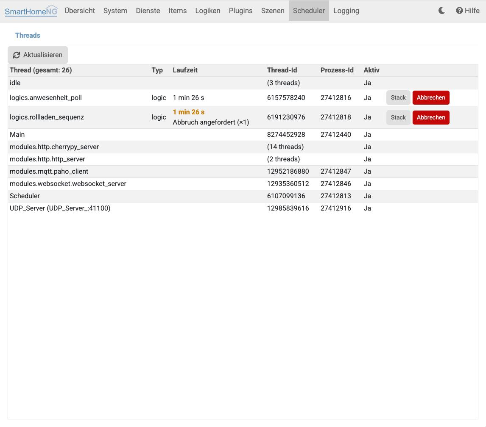

.. index:: Admin GUI; Threads
.. index:: Threads; Admin GUI

=======
Threads
=======

Unter **Threads** können die in SmartHomeNG laufenden Threads angezeigt werden. Angezeigt wird der Thread Name und die ID
des Threads. Einige spezielle Threads werden zusammengefasst und es wird nur die Anzahl Threads dieses Typs angezeigt.
Dazu gehören Threads vom Typ **CP Server** und **HTTPServer** die von CherryPy erzeugt werden und Threads welche **idle**
sind.

Die Liste wird beim Öffnen der Seite geladen und mit dem Button **Aktualisieren** neu geladen.

.. index:: Threads; Laufende Tasks

Laufende Tasks
==============

Worker-Threads des Schedulers, die gerade einen Task ausführen, tragen den Namen des Tasks (z.B. ``logics.meine_logik``).
Für sie zeigt die Liste zusätzlich:

- **Typ**: ``logic`` für Logiken, ``item`` für Item-Zyklen, Crontabs und Autotimer, ``method`` für Scheduler-Einträge
  von Plugins und Core.
- **Laufzeit**: Zeit seit dem Start des Tasks. Hat der Task die Schwelle ``runtime_warn`` überschritten, wird die Laufzeit
  hervorgehoben (Standard 120 Sekunden, einstellbar in ``smarthome.yaml``, für Logiken auch pro Logik, siehe
  :doc:`Standardparameter von Logiken </referenz/logiken/logiken_standardparameter>`).

Beim Überschreiten von ``runtime_warn`` und erneut bei jeder Verdopplung der Laufzeit wird zusätzlich eine Warnung mit dem
aktuellen Stacktrace des Tasks geloggt, für Logiken in das Log der Logik.

Der Button **Stack** zeigt die Stelle im Code, an der der Task gerade ausgeführt wird. Wechselt die Stelle zwischen zwei
Aufrufen, läuft der Task in einer Schleife. Bleibt sie gleich, wartet er in einem blockierenden Aufruf.

.. index:: Threads; Logik abbrechen
.. _admin_threads_abbrechen:

Logik abbrechen
===============

Laufende Logiken können mit dem Button **Abbrechen** (in der Liste oder im Stack-Dialog) nach einer Bestätigung
abgebrochen werden. Tasks anderer Typen (Item-Zyklen, Plugin-Methoden) können nicht abgebrochen werden, da sie z.B. Locks
halten können, die ein Abbruch belegt zurücklassen würde.

Der Abbruch löst in der Logik die Exception :ref:`TaskCancelled <logik_exceptions_taskcancelled>` aus. Wann sie wirkt,
hängt davon ab, was die Logik gerade tut:

- In einer Rechenschleife wird die Logik sofort abgebrochen.
- In einem blockierenden Aufruf (``time.sleep()``, ``Event.wait()``, Netzwerkzugriff, ``subprocess``) erst, wenn dieser
  zurückkehrt. Eine Logik, die in ``time.sleep(1)``-Schritten wartet, wird also nach spätestens einer Sekunde abgebrochen,
  eine Logik in ``time.sleep(600)`` erst nach Ablauf der 600 Sekunden.
- Ein ``except:`` ohne Exception-Typ in der Logik verschluckt den Abbruch, die Logik läuft weiter.

Solange der Abbruch angefordert, aber noch nicht wirksam ist, zeigt die Liste unter der Laufzeit
**Abbruch angefordert (×N)**. Der Abbruch kann erneut angefordert werden, z.B. wenn die Logik ihn verschluckt hat.

Der abgebrochene Lauf wird mit der Stelle, an der er unterbrochen wurde, als Warnung in das Log der Logik geschrieben.

Logiken können mit dem Parameter ``runtime_cancel`` auch automatisch nach einer festen Laufzeit abgebrochen werden, siehe
:doc:`Standardparameter von Logiken </referenz/logiken/logiken_standardparameter>`.
