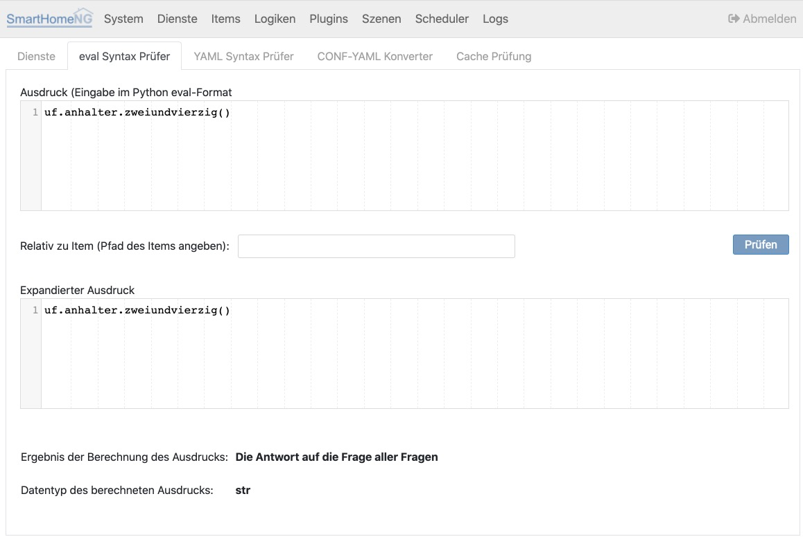

.. role:: bluesup
.. role:: greensup
.. role:: redsup

.. index:: Konfiguration; Userfunctions
.. index:: Konfiguration; uf
.. index:: Konfiguration; Functions
.. index:: Userfunctions; Konfiguration

=============
Userfunctions
=============

Es ist möglich, benutzerdefinierte Funktionen (Userfunctions) zu schreiben und in eval Statements sowie in Logiken zu
verwenden. Diese Funktionen können zur Laufzeit verändert und neu geladen werden.

Die Python Dateien mit den Funktionen müssen dazu im Verzeichnis ``etc/functions`` abgelegt werden. Es sind normale
Python Dateien, die mehrere Funktionen enthalten können. Als formale Anforderung sind nur Informationen zur Version
und eine kurze Beschreibung des Zwecks der Funktionen dieser Datei anzugeben.

Im folgenden Beispiel wird eine Datei (Funktionssammlung) mit dem Namen ``anhalter.py`` im Verzeichnis ``etc/functions``
erzeugt:

Die Python Datei sieht folgendermaßen aus:

.. code-block:: python
   :caption: etc/functions/anhalter.py

   #!/usr/bin/env python3
   # anhalter.py

   _VERSION     = '0.1.0'
   _DESCRIPTION = 'Per Anhalter durch die Galaxis'

   def zweiundvierzig():

       return 'Die Antwort auf die Frage aller Fragen'

Wenn nach dem Erstellen dieser Datei SmartHomeNG neu gestartet wird, sieht man im Warnings-Log, dass die Datei
importiert wird:

.. code::

   2026-11-25  20:07:08 NOTICE   lib.smarthome       --------------------   Init SmartHomeNG 2.0.0+4e0938c2.master   --------------------
   2026-11-25  20:07:08 NOTICE   lib.smarthome       Running in Python interpreter 'v3.13.5 final' in virtual environment, from directory /usr/local/smarthome
   2026-11-25  20:07:08 NOTICE   lib.smarthome        - operating system 'Debian GNU/Linux 13.2 (trixie)' (pid=4584)
   2026-11-25  20:07:08 NOTICE   lib.smarthome        - on '<CPU>'
   2026-11-25  20:07:11 NOTICE   lib.userfunctions   Userfunctions importiert aus 'anhalter' v0.1.0 - Per Anhalter durch die Galaxis
   2026-11-25  20:08:25 NOTICE   lib.smarthome       --------------------   SmartHomeNG initialization finished   --------------------

Nun kann man die in der Datei definierten Funktionen nutzen. Allen Userfunctions ist beim Aufruf **uf.** (für
userfunctions) gefolgt von dem Namen der Datei voranzustellen. Die Funktion **zweiundvierzig** ist also als
**uf.anhalter.zweiundvierzig()** aufzurufen.  In der Admin GUI im eval Syntax Checker sieht das denn folgendermaßen
aus:

Analog können die Funtionen in **eval** Attributen in Item Definitionen und in Logiken aufgerufen werden.

Weitere Details zu Userfunctions sind im Abschnitt :doc:`Referenz </referenz/userfunctions/userfunctions>` zu finden.

